# The Definitive Kotlin & Android Internals Interview Guide
### Tailored for Senior, Staff, Principal, & Architect Android Engineers (15+ Years Experience)


> **Purpose of this Document:**
> At the 15-year experience mark, interviewers rarely stop at *"What is the difference between `val` and `var`?"*. Even when they ask a foundational question, they are testing whether you understand **what the Kotlin compiler emits in Java bytecode**, **how the ART runtime/GC handles those allocations**, **how R8 optimizes them**, and **how those choices affect large-scale architecture, binary size, and frame-rate stability**.
>
> This guide covers **Foundational → Intermediate → Advanced Internals → Staff/Principal Architectural Scenarios**, complete with **decompiled Java bytecode explanations**, **visual Mermaid architecture & sequence diagrams**, **runnable code examples**, **memory/GC implications**, and **production war-story scenarios**.

---

## Table of Contents

1. [Core Kotlin Language Mechanics & Bytecode Internals](#1-core-kotlin-language-mechanics--bytecode-internals)
2. [Functions, Lambdas, Inlining & Control Flow](#2-functions-lambdas-inlining--control-flow)
3. [Type System, Generics, Variance & Contracts](#3-type-system-generics-variance--contracts)
4. [Delegation, Reflection, KSP & Metaprogramming](#4-delegation-reflection-ksp--metaprogramming)
5. [Coroutines Internals & Structured Concurrency](#5-coroutines-internals--structured-concurrency)
6. [Reactive Streams: Kotlin Flow, StateFlow, SharedFlow & Channels](#6-reactive-streams-kotlin-flow-stateflow-sharedflow--channels)
7. [Memory Management, JVM Interop, ART & R8 Optimizations](#7-memory-management-jvm-interop-art--r8-optimizations)
8. [Jetpack Compose Compiler & Runtime Internals](#8-jetpack-compose-compiler--runtime-internals)
9. [Kotlin Multiplatform (KMP) Architecture & Internals](#9-kotlin-multiplatform-kmp-architecture--internals)
10. [Gradle Kotlin DSL, Build Performance & K2 Compiler](#10-gradle-kotlin-dsl-build-performance--k2-compiler)
11. [Staff / Principal Level Architectural & Production Scenarios](#11-staff--principal-level-architectural--production-scenarios)

---

## 1. Core Kotlin Language Mechanics & Bytecode Internals

### Q1.1: What happens under the hood with `val` vs `const val`? Is `val` truly immutable?
**Level:** Foundational → Intermediate

#### Technical Answer:
* **`val` is read-only, NOT immutable:** `val` only means no setter is generated in the bytecode. It generates a `private` backing field (if needed) and a `public final getX()` getter method.
  * If a `val` has a custom getter (`val currentTime: Long get() = System.currentTimeMillis()`), no backing field is generated at all, and every access returns a different value.
  * If a `val` points to a mutable collection (`val list = ArrayList<String>()`), the reference cannot be reassigned, but the underlying heap object can be mutated.
* **`const val` is a compile-time constant:**
  * Allowed only at the top-level or inside an `object` / `companion object`, and only for primitive types or `String`.
  * Generates a `public static final` field in bytecode.
  * **Crucial Compiler Optimization:** The Kotlin/Java compiler **inlines** the value of a `const val` directly into the call site's constant pool. There is no method invocation (`getX()`) and no field lookup at runtime.

#### Code Example: Why `val` != Immutable
```kotlin
class AccountPortfolio {
    // 1. Backing field + getter, but underlying list is mutable!
    val transactions: MutableList<String> = mutableListOf("TX_1")

    // 2. Custom getter: NO backing field in bytecode! Returns a new value on every read!
    val lastAccessedTimestamp: Long
        get() = System.currentTimeMillis()
}

fun main() {
    val portfolio = AccountPortfolio()
    portfolio.transactions.add("TX_2") // Legal! `val` only locks the reference, not the object contents.
    println(portfolio.transactions)    // [TX_1, TX_2]
}
```

#### Decompiled Java Bytecode Comparison:
```kotlin
object Config {
    const val TIMEOUT_MS = 5000L
    val DEFAULT_HOST = "https://api.finpulse.com"
}

fun connect() {
    val t = Config.TIMEOUT_MS
    val h = Config.DEFAULT_HOST
}
```
Decompiles to:
```java
public final class Config {
   public static final long TIMEOUT_MS = 5000L; // Inlined at call-sites!
   @NotNull
   private static final String DEFAULT_HOST = "https://api.finpulse.com";
   @NotNull
   public static final Config INSTANCE = new Config();

   @NotNull
   public final String getDEFAULT_HOST() { // Requires a virtual/static method call!
      return DEFAULT_HOST;
   }
}

// Call site in connect():
public static final void connect() {
   long t = 5000L; // <-- Notice Config.TIMEOUT_MS was completely erased and replaced with literal 5000L!
   String h = Config.INSTANCE.getDEFAULT_HOST(); // <-- Method call on singleton INSTANCE
}
```

---

### Q1.2: Compare `lateinit var` vs `by lazy`. How do they work at the bytecode and thread-safety levels?
**Level:** Intermediate → Advanced

#### Technical Answer:
| Feature | `lateinit var` | `by lazy` |
| :--- | :--- | :--- |
| **Mutability** | Mutable (`var`) — can be reassigned multiple times. | Read-only (`val`) — computed once and cached. |
| **Allowed Types** | Non-nullable reference types only. **No primitives** (`Int`, `Long`, `Boolean`) and no nullable types (`String?`). | Any type (primitives, nullable types, objects). |
| **Thread Safety** | **Not thread-safe.** No synchronization around initialization. | **Thread-safe by default** (`LazyThreadSafetyMode.SYNCHRONIZED`). |
| **Bytecode Mechanism** | Exposes the backing field directly with the same visibility as the property. Uses `null` as the uninitialized sentinel value. | Allocates a `Lazy<T>` wrapper object (`SynchronizedLazyImpl`) on the heap and generates a delegated `getX()` method. |

#### Decompiled Bytecode of `lateinit var` & `.isInitialized`:
```kotlin
class MainActivity : Activity() {
    lateinit var analyticsTracker: AnalyticsTracker

    fun logScreen() {
        if (this::analyticsTracker.isInitialized) {
            analyticsTracker.track("Home")
        }
    }
}
```
Decompiles to:
```java
public final class MainActivity extends Activity {
   public AnalyticsTracker analyticsTracker; // Default value on JVM heap is null!

   @NotNull
   public final AnalyticsTracker getAnalyticsTracker() {
      AnalyticsTracker var10000 = this.analyticsTracker;
      if (var10000 == null) {
         Intrinsics.throwUninitializedPropertyAccessException("analyticsTracker");
      }
      return var10000;
   }

   public final void setAnalyticsTracker(@NotNull AnalyticsTracker var1) {
      this.analyticsTracker = var1;
   }

   public final void logScreen() {
      // Notice `this::analyticsTracker.isInitialized` compiles to a simple null check on the backing field!
      if (this.analyticsTracker != null) {
         this.getAnalyticsTracker().track("Home");
      }
   }
}
```

#### Visual Diagram: `by lazy` Thread-Safety Modes (`LazyThreadSafetyMode`)
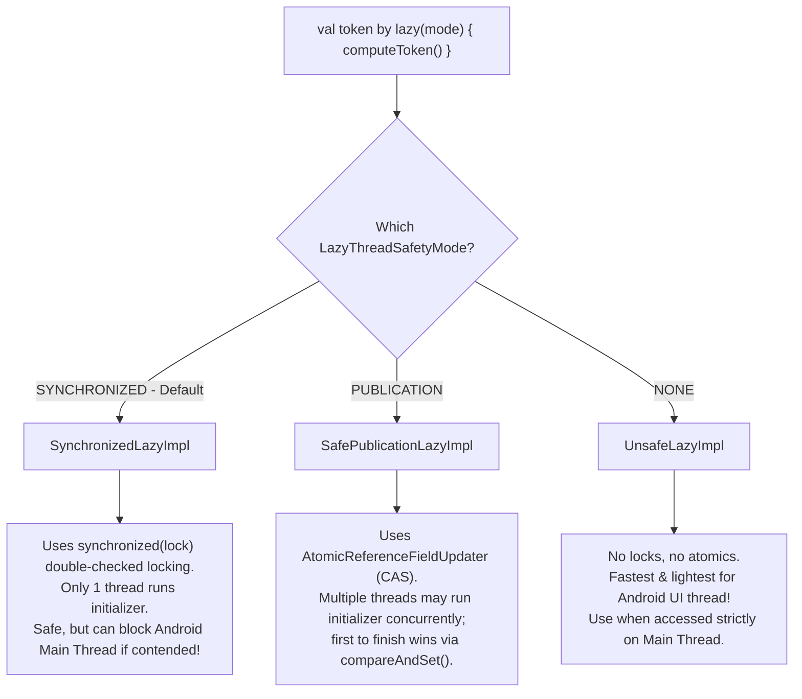

---

### Q1.3: Explain `@JvmInline value class` vs `typealias` vs single-property `data class`. When does a `value class` still get boxed on the heap?
**Level:** Advanced

#### Memory Layout Diagram: `data class` vs `@JvmInline value class`
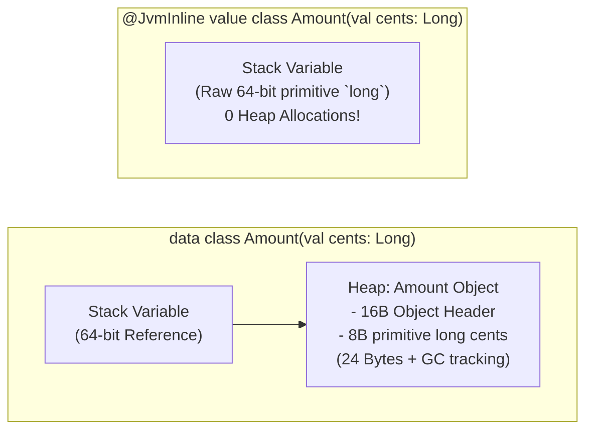

#### Code Example: When `@JvmInline value class` Unboxes vs. Boxes!
```kotlin
interface Payable
@JvmInline
value class Cents(val amount: Long) : Payable

fun acceptRawValue(c: Cents) {}          // 1. UNBOXED -> compiles to acceptRawValue-xxxx(long c)
fun acceptNullable(c: Cents?) {}         // 2. BOXED   -> compiles to acceptNullable(Cents c)
fun <T> acceptGeneric(item: T) {}        // 3. BOXED   -> compiles to acceptGeneric(Object item)
fun acceptInterface(p: Payable) {}       // 4. BOXED   -> compiles to acceptInterface(Payable p)

fun demo() {
    val price = Cents(5000L)             // Raw `long price = 5000L;` on the stack!
    acceptRawValue(price)                // Zero heap allocation! Passes raw `5000L`!

    acceptNullable(price)                // Allocates `Cents.box-impl(price)` on the heap!
    acceptGeneric(price)                 // Allocates `Cents.box-impl(price)` on the heap!
    acceptInterface(price)               // Allocates `Cents.box-impl(price)` on the heap!
    val list: List<Cents> = listOf(price)// Every element inside a generic List is BOXED!
}
```

#### Decompiled Bytecode of `@JvmInline value class`
```java
public final class Cents implements Payable {
   private final long amount;

   // Constructor is private; static constructor-impl validates and returns raw `long`!
   public static long constructor_impl/* $FF was: constructor-impl */(long amount) {
      return amount;
   }

   // Used ONLY when boxing is required (generics, nullable, interface):
   public static final Cents box_impl/* $FF was: box-impl */(long v) {
      return new Cents(v);
   }
}
```

---

### Q1.4: `object` vs `companion object` — How are they initialized, and are they truly singletons?
**Level:** Intermediate → Advanced

#### Code & Decompiled Bytecode Comparison:
```kotlin
class TransactionValidator {
    companion object {
        val MAX_LIMIT = 10_000        // Without const or @JvmField
        @JvmField val MIN_LIMIT = 1   // With @JvmField

        fun validate(amount: Int): Boolean = amount in MIN_LIMIT..MAX_LIMIT

        @JvmStatic
        fun validateFast(amount: Int): Boolean = amount in MIN_LIMIT..MAX_LIMIT
    }
}
```
Decompiles to **TWO classes** (`TransactionValidator.class` and `TransactionValidator$Companion.class`):
```java
public final class TransactionValidator {
   private static final int MAX_LIMIT = 10000;
   @JvmField
   public static final int MIN_LIMIT = 1; // Direct static field access!
   @NotNull
   public static final Companion Companion = new Companion(null); // Extra heap instance!

   @JvmStatic
   public static final boolean validateFast(int amount) {
      return Companion.validateFast(amount);
   }

   public static final class Companion {
      public final int getMAX_LIMIT() {
         return TransactionValidator.MAX_LIMIT;
      }
      public final boolean validate(int amount) { ... }
      public final boolean validateFast(int amount) { ... }
   }
}
```

---

### Q1.5: `sealed class` vs `sealed interface` vs `enum class` — Memory, Bytecode, and Binary Compatibility
**Level:** Intermediate → Advanced

#### Code Example: Why `sealed interface` enables Diamond Composition & `value class` Subtypes
```kotlin
// Shared error contract across multiple feature flows:
sealed interface CommonNetworkError {
    data object NoInternet : CommonNetworkError, LoginResult, TransferResult
    data object ServerTimeout : CommonNetworkError, LoginResult, TransferResult
}

sealed interface LoginResult {
    // A @JvmInline value class CAN implement a sealed interface (cannot extend a sealed class!):
    @JvmInline
    value class Success(val authToken: String) : LoginResult
    data object InvalidCredentials : LoginResult
}

sealed interface TransferResult {
    @JvmInline
    value class Completed(val receiptId: String) : TransferResult
    data object InsufficientFunds : TransferResult
}

fun handleLogin(result: LoginResult) = when (result) {
    is LoginResult.Success -> println("Token: ${result.authToken}") // Zero wrapper allocation!
    LoginResult.InvalidCredentials -> println("Bad password")
    CommonNetworkError.NoInternet -> println("Offline")
    CommonNetworkError.ServerTimeout -> println("Retry later")
}
```

---

## 2. Functions, Lambdas, Inlining & Control Flow

### Q2.1: How are Lambdas compiled in Kotlin? What is the difference between a capturing and non-capturing lambda?
**Level:** Advanced (Crucial for Android Memory & GC interviews)

#### Visual Diagram: Non-Capturing vs Capturing Lambda Memory Allocations
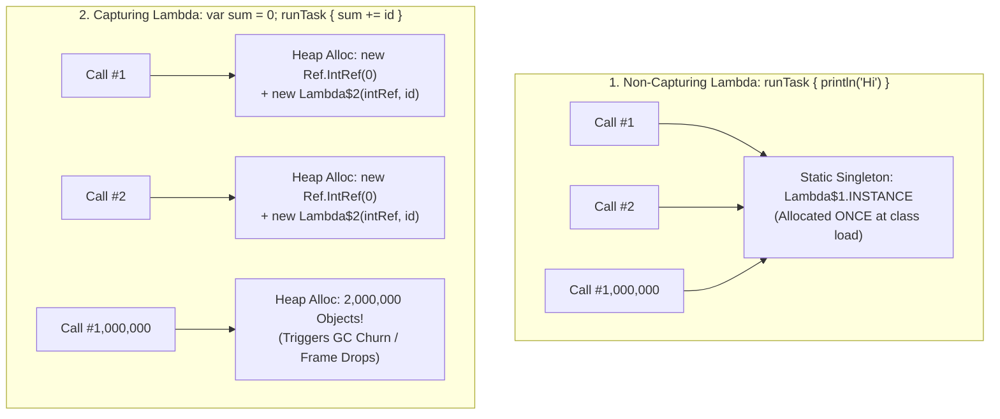

#### Code & Decompiled Bytecode of a Capturing Lambda:
```kotlin
// Note: NOT inline!
fun executeAsync(block: () -> Unit) {
    block.invoke()
}

fun processItems(prefix: String) {
    var processedCount = 0
    executeAsync {
        processedCount++
        println("$prefix: $processedCount")
    }
}
```
Decompiles to:
```java
public static final void processItems(@NotNull final String prefix) {
   // 1. Local `var processedCount` is wrapped in a heap-allocated IntRef object!
   final Ref.IntRef processedCount = new Ref.IntRef();
   processedCount.element = 0;

   // 2. A new Function0 instance is allocated on the heap every time processItems() runs!
   executeAsync((Function0)(new Function0() {
      public final void invoke() {
         processedCount.element++;
         System.out.println(prefix + ": " + processedCount.element);
      }
   }));
}
```

---

### Q2.2: Explain `inline`, `noinline`, and `crossinline` in deep detail. When should you NOT use `inline`?
**Level:** Advanced

#### Code Example Comparing Normal, `noinline`, and `crossinline`
```kotlin
inline fun executeTransaction(
    // 1. Inlined directly: allows non-local `return` & zero Function0 allocation
    beforeTransaction: () -> Unit,
    // 2. noinline: Cannot be inlined because we pass it as an Object to a worker queue!
    noinline onAuditLog: () -> Unit,
    // 3. crossinline: Inlined inside the Runnable, so non-local `return` is FORBIDDEN!
    crossinline onUiComplete: () -> Unit
) {
    beforeTransaction()

    AuditQueue.enqueue(onAuditLog) // Requires a real Function0 object -> must be `noinline`!

    Handler(Looper.getMainLooper()).post(Runnable {
        // Inlined inside Runnable.run(), NOT in executeTransaction's stack frame!
        // Therefore, a bare `return` inside onUiComplete would be impossible -> must be `crossinline`!
        onUiComplete()
    })
}

fun runCheckout(amount: Double) {
    executeTransaction(
        beforeTransaction = {
            if (amount <= 0) return // Non-local return: exits `runCheckout()` completely!
        },
        onAuditLog = {
            println("Audited $amount")
            // `return` here is a compile error; must use `return@executeTransaction`
        },
        onUiComplete = {
            println("UI Updated")
            // `return` here is a compile error due to `crossinline`!
        }
    )
}
```

#### The Pro Pattern for Large Inline Functions (`@PublishedApi internal`):
```kotlin
// BAD: Inlining 50 lines of heavy setup/teardown logic into every call site bloats DEX size!
// GOOD: Keep the inline function tiny and delegate heavy non-lambda work to @PublishedApi internal functions!
@PublishedApi
internal fun acquireDatabaseTransaction(db: Database) { /* 30 lines of setup */ }

@PublishedApi
internal fun releaseDatabaseTransaction(db: Database, success: Boolean) { /* 30 lines of cleanup */ }

inline fun <T> Database.withTransaction(block: () -> T): T {
    acquireDatabaseTransaction(this)
    var success = false
    try {
        val result = block() // Only the 5-line try/finally wrapper and `block()` are inlined!
        success = true
        return result
    } finally {
        releaseDatabaseTransaction(this, success)
    }
}
```

---

### Q2.3: Compare Scope Functions (`let`, `run`, `with`, `apply`, `also`) at the bytecode level. Does chaining `?.let { ... } ?: run { ... }` have hidden traps?
**Level:** Intermediate → Advanced

#### Flowchart: Choosing the Right Scope Function
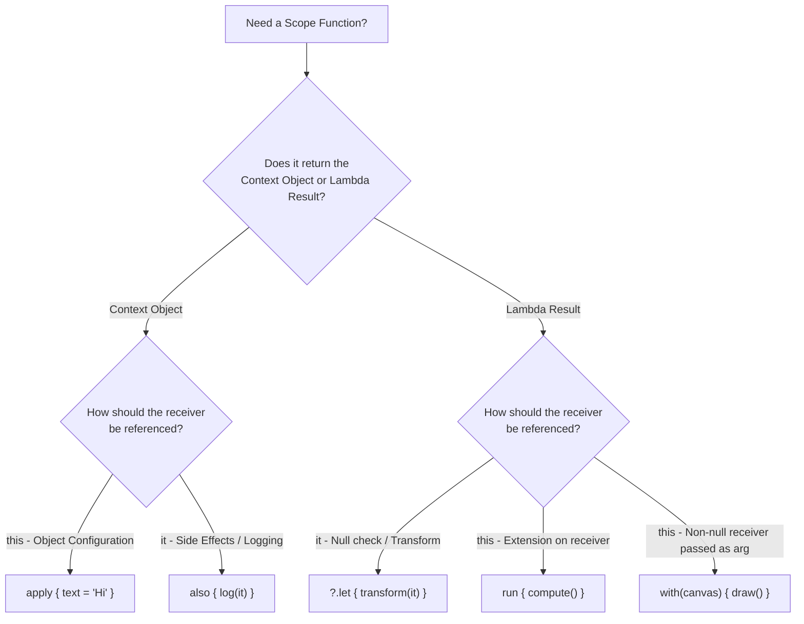

#### Code Example: The `?.let { ... } ?: run { ... }` Bug in Action
```kotlin
class UserCache {
    // Returns previous cached value, which is `null` the first time a user is cached!
    fun put(user: String): String? = null
}

fun handleUserBuggy(user: String?, cache: UserCache) {
    user?.let {
        cache.put(it) // Evaluates to `null`!
    } ?: run {
        // BUG: This block runs even when `user` is "Alice", because `cache.put("Alice")` returned `null`!
        println("ERROR: User was null!")
    }
}

fun handleUserSafe(user: String?, cache: UserCache) {
    // FIX 1: Use `also` because `also` ALWAYS returns the non-null `user` receiver!
    user?.also {
        cache.put(it)
    } ?: run {
        println("User was genuinely null!")
    }
}
```

---

## 3. Type System, Generics, Variance & Contracts

### Q3.1: Explain Kotlin's Type Hierarchy (`Any`, `Unit`, `Nothing`). How does `Nothing` work in bytecode and why is it the "bottom type"?
**Level:** Intermediate → Advanced

#### Visual Diagram: The Kotlin Type Lattice
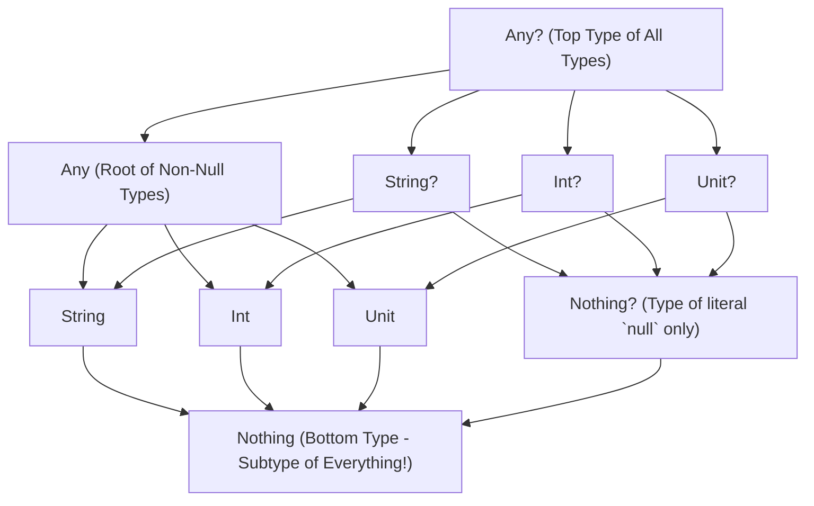

#### Code Example: Exploiting `Nothing` for Clean Architecture & Compiler Exhaustiveness
```kotlin
// 1. Custom fail helper returning Nothing allows smart-casting without explicit return!
fun failValidation(message: String): Nothing {
    throw IllegalArgumentException(message)
}

fun processPayment(amount: Double?) {
    // Because `failValidation` returns `Nothing` (which is a subtype of `Double`),
    // the compiler infers `validAmount` as non-null `Double`!
    val validAmount: Double = amount ?: failValidation("Amount is required")
    println("Processing ${validAmount * 1.05}")
}

// 2. Why StateFlow.collect returns `Nothing`:
// `public suspend fun collect(collector: FlowCollector<T>): Nothing`
// Because StateFlow never completes normally (only via cancellation exception), its return type is `Nothing`!
suspend fun observeState(stateFlow: kotlinx.coroutines.flow.StateFlow<Int>) {
    stateFlow.collect { println(it) }
    // The Kotlin compiler marks any code below `stateFlow.collect` as "Unreachable code" automatically!
}
```

---

### Q3.2: Deep Dive into Generics Variance: Invariance, Covariance (`out`), Contravariance (`in`), Declaration-Site vs. Use-Site Variance, and Star Projection (`*`).
**Level:** Advanced

#### Visual Diagram: Subtyping Direction for Invariance, Covariance (`out`), and Contravariance (`in`)
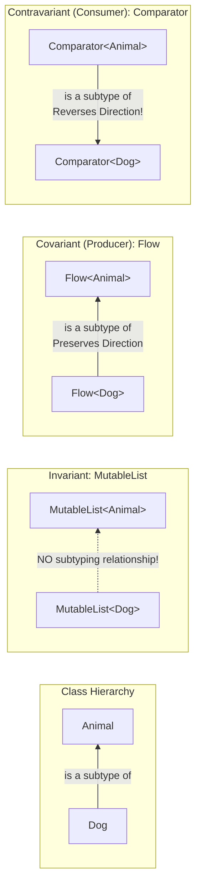

#### Code Example: Producer (`out`) vs Consumer (`in`) in a Real Payment Pipeline
```kotlin
open class Transaction(val id: String, val amount: Double)
class CardTransaction(id: String, amount: Double, val last4Digits: String) : Transaction(id, amount)

// 1. COVARIANT (out T): Only PRODUCES T (Return positions only)
interface TransactionSource<out T : Transaction> {
    fun nextTransaction(): T
    // fun save(item: T) // <-- COMPILE ERROR: Type parameter T is declared as 'out' but occurs in 'in' position!
}

// 2. CONTRAVARIANT (in T): Only CONSUMES T (Parameter positions only)
interface TransactionAuditor<in T : Transaction> {
    fun audit(transaction: T)
    // fun getLastAudited(): T // <-- COMPILE ERROR: Type parameter T is declared as 'in' but occurs in 'out' position!
}

fun runAuditPipeline(
    cardSource: TransactionSource<CardTransaction>,
    generalAuditor: TransactionAuditor<Transaction>
) {
    // Works because TransactionSource<CardTransaction> IS A subtype of TransactionSource<Transaction> (out)
    val generalSource: TransactionSource<Transaction> = cardSource

    // Works because TransactionAuditor<Transaction> IS A subtype of TransactionAuditor<CardTransaction> (in)
    val cardAuditor: TransactionAuditor<CardTransaction> = generalAuditor

    val cardTx: CardTransaction = cardSource.nextTransaction()
    cardAuditor.audit(cardTx)
}
```

---

### Q3.3: How does Type Erasure work, and how do `inline` + `reified` bypass it? Can `reified` do everything reflection can?
**Level:** Intermediate → Advanced

#### Code Example: Preserving Nested Generic Types with `reified` + `typeOf<T>()`
```kotlin
import kotlin.reflect.KType
import kotlin.reflect.typeOf

// 1. Standard reified: great for top-level classes, but `T::class.java` loses nested generics (`List<User>`)
inline fun <reified T : Any> parseSimple(json: String): Class<T> {
    return T::class.java // If T is List<String>, this only returns `java.util.List.class`!
}

// 2. Advanced reified with `typeOf<T>()`: Preserves FULL nested generic type arguments at compile time!
inline fun <reified T> inspectFullGenericType(): KType {
    return typeOf<T>()
}

fun main() {
    val kType: KType = inspectFullGenericType<Map<String, List<Int>>>()
    println(kType) // Prints: kotlin.collections.Map<kotlin.String, kotlin.collections.List<kotlin.Int>>
    println(kType.arguments) // [kotlin.String, kotlin.collections.List<kotlin.Int>]
}
```

---

### Q3.4: What are Kotlin Contracts (`kotlin.contracts`) and how do they enhance the compiler's control-flow graph?
**Level:** Advanced

#### Code Example: Writing Both `returns() implies` and `callsInPlace` Contracts
```kotlin
import kotlin.contracts.ExperimentalContracts
import kotlin.contracts.InvocationKind
import kotlin.contracts.contract

sealed interface ApiResponse<out T> {
    data class Success<T>(val data: T) : ApiResponse<T>
    data class Error(val code: Int) : ApiResponse<Nothing>
}

// Contract Example 1: Smart-casting a sealed hierarchy via a helper extension function!
@OptIn(ExperimentalContracts::class)
fun <T> ApiResponse<T>.isSuccess(): Boolean {
    contract {
        returns(true) implies (this@isSuccess is ApiResponse.Success<T>)
    }
    return this is ApiResponse.Success<T>
}

// Contract Example 2: Allowing `val` initialization inside a custom performance-measuring block!
@OptIn(ExperimentalContracts::class)
inline fun <R> measureAndLog(tag: String, block: () -> R): R {
    contract {
        callsInPlace(block, InvocationKind.EXACTLY_ONCE)
    }
    val start = System.nanoTime()
    try {
        return block()
    } finally {
        val elapsedMs = (System.nanoTime() - start) / 1_000_000
        println("[$tag] took ${elapsedMs}ms")
    }
}

fun handleResponse(response: ApiResponse<String>) {
    val payload: String
    measureAndLog("ParseResponse") {
        // Without `callsInPlace(EXACTLY_ONCE)`, assigning `val payload` here is a COMPILE ERROR!
        payload = if (response.isSuccess()) {
            // Without `returns(true) implies ...`, `response.data` here is a COMPILE ERROR!
            response.data
        } else {
            "Fallback"
        }
    }
    println(payload)
}
```

---

## 4. Delegation, Reflection, KSP & Metaprogramming

### Q4.1: How do Class Delegation (`by`) and Property Delegation (`ReadOnlyProperty` / `ReadWriteProperty`) work in bytecode?
**Level:** Intermediate → Advanced

#### Code Example 1: The "Broken Delegation" (Self-Reference) Pitfall with `by`
```kotlin
interface AnalyticsLogger {
    fun logEvent(name: String)
    fun formatEvent(name: String): String
}

class DefaultAnalyticsLogger : AnalyticsLogger {
    override fun logEvent(name: String) {
        // Calls `this.formatEvent(name)` where `this` is DefaultAnalyticsLogger!
        println(formatEvent(name))
    }
    override fun formatEvent(name: String): String = "[DEFAULT] $name"
}

class RedactingAnalyticsLogger(
    private val delegate: AnalyticsLogger
) : AnalyticsLogger by delegate {
    // We override formatEvent expecting `logEvent()` to use our redacted format:
    override fun formatEvent(name: String): String = "[REDACTED] ${name.take(3)}***"
}

fun main() {
    val logger = RedactingAnalyticsLogger(DefaultAnalyticsLogger())
    logger.logEvent("SecretAccount123")
    // OUTPUT: "[DEFAULT] SecretAccount123" (NOT "[REDACTED] Sec***"!)
    // WHY? Because `logger.logEvent()` forwards to `delegate.logEvent()`,
    // and inside `DefaultAnalyticsLogger`, `this` is `delegate`, NOT `RedactingAnalyticsLogger`!
}
```

#### Code Example 2: Zero-Allocation Custom Property Delegate with `ReadWriteProperty`
```kotlin
import android.os.Bundle
import kotlin.properties.ReadWriteProperty
import kotlin.reflect.KProperty

class BundleStringDelegate(
    private val bundle: Bundle,
    private val customKey: String? = null
) : ReadWriteProperty<Any?, String?> {

    override fun getValue(thisRef: Any?, property: KProperty<*>): String? {
        return bundle.getString(customKey ?: property.name)
    }

    override fun setValue(thisRef: Any?, property: KProperty<*>, value: String?) {
        bundle.putString(customKey ?: property.name, value)
    }
}

class PaymentArgs(bundle: Bundle) {
    var transactionId: String? by BundleStringDelegate(bundle)
    var merchantName: String? by BundleStringDelegate(bundle, customKey = "EXTRA_MERCHANT")
}
```

---

### Q4.2: Why is `kapt` so slow on Android, and how does KSP (Kotlin Symbol Processing) achieve up to 2x faster builds?
**Level:** Advanced / Staff Build Architecture

#### Pipeline Diagram: `kapt` vs `KSP` Compilation Phases
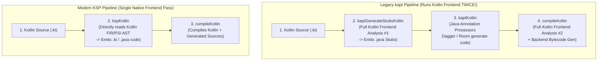

---

## 5. Coroutines Internals & Structured Concurrency

### Q5.1: How does a `suspend` function actually work under the hood? Explain Continuation Passing Style (CPS) and the generated State Machine in Java Bytecode.
**Level:** Advanced (Must-know for Senior/Staff interviews)

#### State-Machine Diagram of a 2-Suspension-Point Function
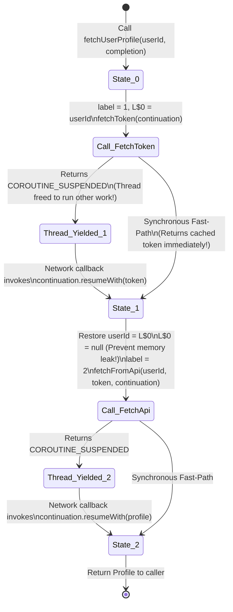

#### Kotlin Source vs. Decompiled Java State Machine:
```kotlin
suspend fun fetchUserProfile(userId: String): Profile {
    val token = fetchToken()                  // Suspension Point 1 (State 0 -> 1)
    val profile = fetchFromApi(userId, token) // Suspension Point 2 (State 1 -> 2)
    return profile
}
```
Decompiled Java pseudo-bytecode:
```java
public final Object fetchUserProfile(String userId, Continuation $completion) {
    // 1. Allocate ONE ContinuationImpl state-machine object for this invocation
    FetchUserProfileContinuation $continuation;
    if ($completion instanceof FetchUserProfileContinuation &&
        (($continuation = (FetchUserProfileContinuation)$completion).label & Integer.MIN_VALUE) != 0) {
        $continuation.label -= Integer.MIN_VALUE;
    } else {
        $continuation = new FetchUserProfileContinuation(this, $completion);
    }

    Object $result = $continuation.result;
    Object COROUTINE_SUSPENDED = IntrinsicsKt.getCOROUTINE_SUSPENDED();
    Object token;

    switch ($continuation.label) {
        case 0:
            ResultKt.throwOnFailure($result); // If resumed with exception, rethrow immediately!
            $continuation.L$0 = userId;       // Spill `userId` to heap field L$0 across suspension point!
            $continuation.label = 1;          // Advance state machine to State 1
            token = fetchToken($continuation);
            if (token == COROUTINE_SUSPENDED) {
                return COROUTINE_SUSPENDED;   // Unwind stack & release OS thread!
            }
            break;
        case 1:
            userId = (String) $continuation.L$0; // Restore `userId` from heap field L$0
            ResultKt.throwOnFailure($result);
            token = $result;
            break;
        case 2:
            ResultKt.throwOnFailure($result);
            return $result; // Return final Profile!
        default:
            throw new IllegalStateException("call to 'resume' before 'invoke' with coroutine");
    }

    // Transition from State 1 -> State 2
    $continuation.L$0 = null; // <-- CRITICAL: Null out L$0 so `userId` isn't leaked while waiting on State 2!
    $continuation.label = 2;
    Object profile = fetchFromApi(userId, (String) token, $continuation);
    if (profile == COROUTINE_SUSPENDED) {
        return COROUTINE_SUSPENDED;
    }
    return profile;
}
```

---

### Q5.2: Explain `CoroutineContext` vs `CoroutineScope`. How is `CoroutineContext` implemented under the hood?
**Level:** Intermediate → Advanced

#### Visual Diagram: `CoroutineContext` as an Immutable Persistent Map (`CombinedContext`)
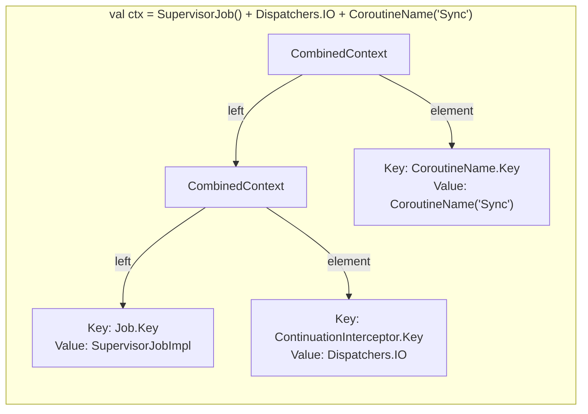

#### Code Example: Inspecting and Overriding `CoroutineContext` Elements
```kotlin
import kotlinx.coroutines.*

fun main() = runBlocking {
    // 1. Combining elements with `+` (right-hand side overwrites matching Key on left-hand side!)
    val baseContext: CoroutineContext = Dispatchers.Default + CoroutineName("WorkerA")
    val overriddenContext: CoroutineContext = baseContext + Dispatchers.IO + CoroutineName("WorkerB")

    // 2. Accessing elements by Companion Object Key (`CoroutineName` companion implements `CoroutineContext.Key<CoroutineName>`)
    println(overriddenContext[CoroutineName])           // CoroutineName(WorkerB)
    println(overriddenContext[ContinuationInterceptor]) // Dispatchers.IO
}
```

---

### Q5.3: `Job` vs `SupervisorJob`, `coroutineScope` vs `supervisorScope`, and the #1 Trap Developers Fall Into!
**Level:** Advanced (High-Frequency Interview Trap)

#### Visual Diagram: Why `scope.launch(SupervisorJob())` Fails vs. How `supervisorScope` Works
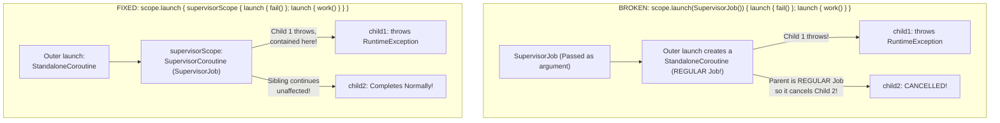

#### Code Example: Comparing Broken vs. Fixed Supervisor Hierarchies
```kotlin
import kotlinx.coroutines.*

// BROKEN PATTERN:
suspend fun brokenSupervisorDemo() {
    val scope = CoroutineScope(Dispatchers.Default)
    scope.launch(SupervisorJob()) { // <-- Creates a regular StandaloneCoroutine with SupervisorJob as its parent!
        launch {
            delay(50)
            throw RuntimeException("Child 1 crashed!")
        }
        launch {
            delay(200)
            println("This will NEVER print because Outer launch is a regular Job!")
        }
    }.join()
}

// FIXED PATTERN 1: Use supervisorScope inside a coroutine
suspend fun fixedWithSupervisorScope() = supervisorScope {
    val handler = CoroutineExceptionHandler { _, e -> println("Caught: ${e.message}") }
    launch(handler) {
        delay(50)
        throw RuntimeException("Child 1 crashed!")
    }
    launch {
        delay(200)
        println("Child 2 survived and completed!") // Prints!
    }
}
```

---

### Q5.4: Exception Handling & Cancellation Internals: `async` vs `launch`, `CoroutineExceptionHandler`, and the Broken Cancellation Trap
**Level:** Advanced

#### Code Example 1: Why `try { async { ... }.await() } catch` STILL Crashes Inside `coroutineScope`!
```kotlin
import kotlinx.coroutines.*
import java.io.IOException

// TRAP: What happens when you run this function?
suspend fun trapAsyncTryCatch() = coroutineScope {
    val deferred = async {
        delay(50)
        throw IOException("Server 500") // Immediately notifies parent `coroutineScope` (regular Job)!
    }

    try {
        deferred.await()
    } catch (e: IOException) {
        println("Caught IOException: ${e.message}")
        // EVEN THOUGH WE CAUGHT IT HERE, `trapAsyncTryCatch()` STILL CRASHES AND THROWS IOException!
        // Why? Because `async` was a child of `coroutineScope` (a standard Job), so the moment
        // `throw IOException` happened inside `async`, it cancelled the parent `coroutineScope`!
    }
}

// FIX: Wrap concurrent `async` calls that might fail independently inside `supervisorScope`!
suspend fun safeAsyncTryCatch() = supervisorScope {
    val deferred = async {
        delay(50)
        throw IOException("Server 500") // Parent is `supervisorScope`, so it does NOT fail parent!
    }

    try {
        deferred.await()
    } catch (e: IOException) {
        println("Safely handled IOException without crashing scope!")
    }
}
```

#### Code Example 2: Safe Coroutine Loop Cancellation & NonCancellable Cleanup
```kotlin
import kotlinx.coroutines.*

suspend fun processBatchSafely(items: List<String>, api: RemoteApi, db: LocalDb) {
    for (item in items) {
        // 1. If doing CPU-heavy work without suspend calls, check `ensureActive()` so loop is cancellable!
        currentCoroutineContext().ensureActive()

        try {
            api.upload(item)
        } catch (e: CancellationException) {
            // 2. Perform urgent suspending cleanup using NonCancellable BEFORE rethrowing!
            withContext(NonCancellable) {
                db.markSyncInterrupted(item)
            }
            throw e // 3. ALWAYS rethrow CancellationException!
        } catch (e: Exception) {
            db.logRecoverableFailure(item, e)
        }
    }
}
```

---

### Q5.5: Dispatchers Internals: How do `Dispatchers.Default`, `Dispatchers.IO`, `Dispatchers.Main`, and `limitedParallelism` work under the hood?
**Level:** Advanced

#### Architecture Diagram: The Shared `CoroutineScheduler` Pool (`Default` + `IO` + `limitedParallelism`)
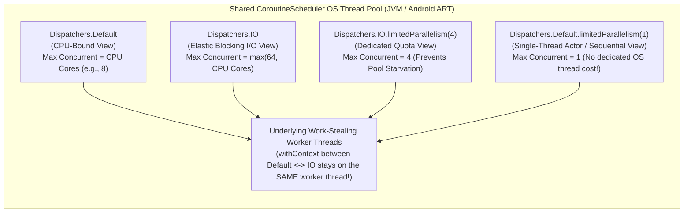

---

## 6. Reactive Streams: Kotlin Flow, StateFlow, SharedFlow & Channels

### Q6.1: How does a Cold `Flow` work under the hood? It's simpler than RxJava—prove it in code!
**Level:** Intermediate → Advanced

#### Sequence Diagram: Sequential Ping-Pong Execution vs `buffer()` / `flowOn()` Channel Execution
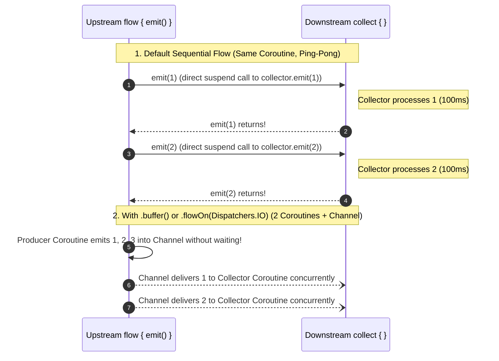

#### Code Example: Building a Mini `Flow` From Scratch (20 Lines of Code!)
```kotlin
// This is literally the core design of kotlinx.coroutines.flow.Flow!
fun interface MiniFlowCollector<in T> {
    suspend fun emit(value: T)
}

interface MiniFlow<out T> {
    suspend fun collect(collector: MiniFlowCollector<T>)
}

fun <T> miniFlow(block: suspend MiniFlowCollector<T>.() -> Unit): MiniFlow<T> =
    object : MiniFlow<T> {
        override suspend fun collect(collector: MiniFlowCollector<T>) {
            collector.block()
        }
    }

// Map operator is just wrapping a new MiniFlow around the upstream collect!
fun <T, R> MiniFlow<T>.map(transform: suspend (T) -> R): MiniFlow<R> = miniFlow {
    this@map.collect { upstreamValue ->
        emit(transform(upstreamValue))
    }
}
```

---

### Q6.2: How does `flowOn`, `buffer`, `conflate`, and `collectLatest` work with Coroutine Channels? What is Operator Fusion?
**Level:** Advanced

#### Visual Diagram: `buffer()` vs `conflate()` vs `collectLatest()`
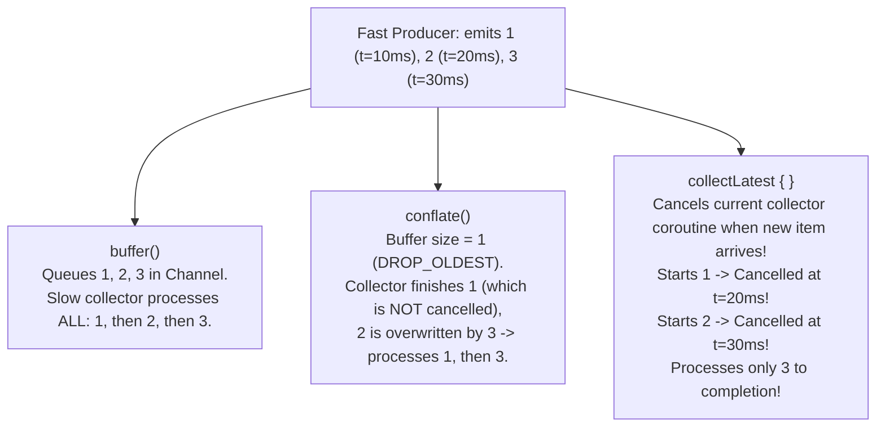

---

### Q6.3: `StateFlow` vs `SharedFlow` vs `Channel` — Deep Architectural Comparison & Edge Cases
**Level:** Advanced (Guaranteed Interview Topic)

#### Code Example 1: Why `stateFlow.value = ...` Has a Race Condition vs `stateFlow.update { ... }`
```kotlin
import kotlinx.coroutines.flow.MutableStateFlow
import kotlinx.coroutines.flow.update

data class PortfolioUiState(
    val isLoading: Boolean = false,
    val balance: Double = 0.0,
    val error: String? = null
)

class PortfolioViewModel {
    private val _uiState = MutableStateFlow(PortfolioUiState())

    // BUGGY under multithreading:
    // If Thread A updates `isLoading` while Thread B updates `balance`, one overwrites the other!
    fun updateBalanceBuggy(newBalance: Double) {
        _uiState.value = _uiState.value.copy(balance = newBalance)
    }

    // THREAD-SAFE: Uses an internal Compare-And-Swap (CAS) spin loop!
    // Under the hood of MutableStateFlow.update:
    // while (true) {
    //     val prevValue = value
    //     val nextValue = function(prevValue)
    //     if (compareAndSet(prevValue, nextValue)) return
    // }
    fun updateBalanceSafe(newBalance: Double) {
        _uiState.update { currentState ->
            currentState.copy(balance = newBalance)
        }
    }
}
```

#### Code Example 2: Safe One-Off UI Events with `Channel` on `Dispatchers.Main.immediate`
```kotlin
import kotlinx.coroutines.channels.Channel
import kotlinx.coroutines.flow.Flow
import kotlinx.coroutines.flow.receiveAsFlow

sealed interface CheckoutEffect {
    data class NavigateToReceipt(val receiptId: String) : CheckoutEffect
    data class ShowSnackbar(val message: String) : CheckoutEffect
}

class CheckoutViewModel : ViewModel() {
    // Buffered Channel ensures events emitted during configuration change (0 collectors)
    // are queued rather than dropped, and delivered to exactly ONE collector upon re-subscription!
    private val _effects = Channel<CheckoutEffect>(capacity = Channel.BUFFERED)
    val effects: Flow<CheckoutEffect> = _effects.receiveAsFlow()

    fun onPaymentConfirmed(receiptId: String) {
        viewModelScope.launch {
            _effects.send(CheckoutEffect.NavigateToReceipt(receiptId))
        }
    }
}
```

---

### Q6.4: Explain `SharingStarted.WhileSubscribed(5000)` and `repeatOnLifecycle(Lifecycle.State.STARTED)`. Why 5000ms?
**Level:** Intermediate → Advanced

#### Timeline Diagram: Screen Rotation vs App Backgrounding with `WhileSubscribed(5000)`
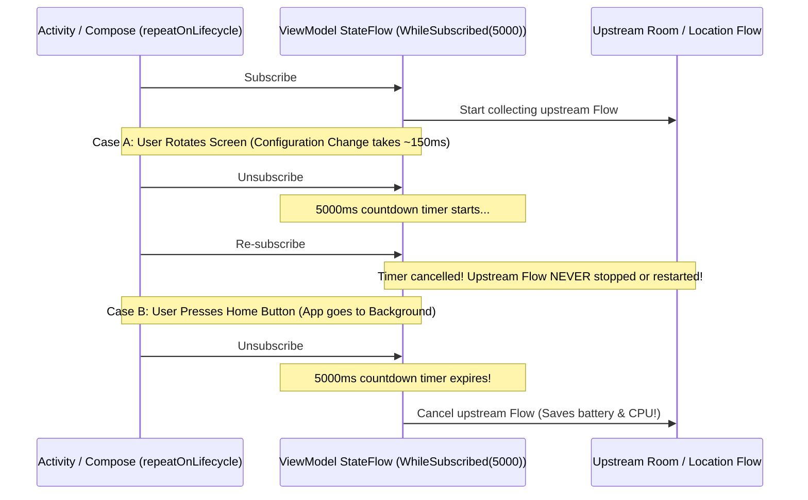

---

## 7. Memory Management, JVM Interop, ART & R8 Optimizations

### Q7.1: What are the hidden costs of Kotlin's `@Metadata` annotation, and how does R8 use it?
**Level:** Advanced / Staff

#### Technical Answer:
Every compiled Kotlin `.class` file has a `@kotlin.Metadata` annotation attached to it containing a serialized **Protocol Buffer (`d1` and `d2` string arrays)**.
* **What's inside `@Metadata`?** All Kotlin-specific language information that Java bytecode doesn't support: nullable vs non-nullable types, `suspend` function signatures, `internal` visibility, `companion object` names, `data class` properties, `sealed` subclasses, and type aliases.
* **Why does it matter for APK size and security?**
  1. **Kotlin Reflection (`kotlin-reflect`)** and libraries like **Moshi (`KotlinJsonAdapterFactory`)** read `@Metadata` at runtime to discover constructor parameter names and nullability.
  2. `@Metadata` strings can account for **several megabytes** of an uncompressed DEX file and expose your internal Kotlin symbol names even after obfuscation if kept blindly!
  3. **R8 Optimization:** In full mode, R8 strips `@kotlin.Metadata` from every class that is **not** targeted by reflection (saving significant APK size). Migrating from reflection-based JSON parsers to **KSP codegen (`@JsonClass(generateAdapter = true)`)** or **`kotlinx.serialization`** allows R8 to strip `@Metadata` and `kotlin-reflect` completely.

---

### Q7.2: Explain `@JvmStatic`, `@JvmField`, `@JvmOverloads`, and `@JvmSynthetic` — Including the Android View Constructor Trap!
**Level:** Intermediate → Advanced

#### Code Example: The `@JvmOverloads` Custom View Bug & Its Fix
```kotlin
// BROKEN: When inflated from XML, Android calls the 2-arg constructor (Context, AttributeSet).
// @JvmOverloads delegates the 2-arg constructor to the 3-arg constructor passing `defStyleAttr = 0`,
// which overrides AppCompatButton's default `R.attr.buttonStyle` with `0`!
class BrokenPulseButton @JvmOverloads constructor(
    context: Context,
    attrs: AttributeSet? = null,
    defStyleAttr: Int = 0 // <-- Wipes out button ripple, padding, text appearance!
) : AppCompatButton(context, attrs, defStyleAttr)

// FIXED: Explicitly supply the default theme attribute as the default value for `defStyleAttr`!
class FixedPulseButton @JvmOverloads constructor(
    context: Context,
    attrs: AttributeSet? = null,
    defStyleAttr: Int = androidx.appcompat.R.attr.buttonStyle // <-- Preserves Material/AppCompat styling!
) : AppCompatButton(context, attrs, defStyleAttr)
```

---

### Q7.3: Subtle Kotlin Memory Leaks in Production Android Apps
**Level:** Advanced / Staff

#### Code & Decompiled Bytecode: Anonymous `object` Leaking `Activity` vs SAM Lambda
```kotlin
fun interface NetworkListener {
    fun onStatusChanged(isOnline: Boolean)
}

class MainActivity : Activity() {
    fun registerListeners(networkMonitor: NetworkMonitor) {
        val tag = "MainScreen" // Local String variable

        // 1. LEAKS MainActivity!
        // Even though `this@MainActivity` is NEVER used inside `onStatusChanged`,
        // an anonymous `object` inside an instance method ALWAYS captures `final MainActivity this$0`!
        networkMonitor.addListener(object : NetworkListener {
            override fun onStatusChanged(isOnline: Boolean) {
                println("[$tag] Online: $isOnline")
            }
        })

        // 2. DOES NOT LEAK MainActivity!
        // A SAM lambda only captures the exact variables it uses (`final String $tag`), NOT `this$0`!
        networkMonitor.addListener(NetworkListener { isOnline ->
            println("[$tag] Online: $isOnline")
        })
    }
}
```

---

## 8. Jetpack Compose Compiler & Runtime Internals

### Q8.1: How does the `@Composable` annotation work? It is NOT an annotation processor!
**Level:** Advanced

#### Code Transformation: What You Write vs. What the Compose IR Compiler Emits
```kotlin
// 1. WHAT YOU WRITE:
@Composable
fun BalanceCard(balance: String) {
    Text(text = balance)
}

// 2. WHAT THE COMPOSE IR COMPILER GENERATES:
fun BalanceCard(balance: String, $composer: Composer?, $changed: Int) {
    val $composer = $composer.startRestartGroup(0x1A2B3C4D)
    var $dirty = $changed

    // Bitmask check: Did the caller already prove `balance` is static/unchanged?
    // If not, ask the Composer Slot Table if `balance.equals(previousSlotValue)` changed:
    if (($changed and 0b0110) == 0) {
        $dirty = $dirty or if ($composer.changed(balance)) 0b0100 else 0b0010
    }

    // If `$dirty` indicates a change OR skipping is disabled, execute the body:
    if (($dirty and 0b0011) != 0b0010 || !$composer.skipping) {
        Text(text = balance, $composer = $composer, $changed = $dirty and 0b1110)
    } else {
        // SMART RECOMPOSITION SKIPPING: Fast-forward the Slot Table cursor to the end of this group!
        $composer.skipToGroupEnd()
    }

    // Register the restart lambda in case a State read inside this group invalidates later:
    $composer.endRestartGroup()?.updateScope { nextComposer, _ ->
        BalanceCard(balance, nextComposer, $changed or 0b0001)
    }
}
```

---

### Q8.2: Explain Compose Stability (`@Stable` vs `@Immutable`), Restartable vs Skippable, and Strong Skipping Mode.
**Level:** Advanced

#### Code Example: Fixing Unstable Classes for Optimal Compose Skipping
```kotlin
// 1. UNSTABLE in Standard Mode:
// - `List<Transaction>` is an interface (could be backed by a mutable ArrayList!).
// - `var isExpanded` is mutable without notifying Compose Snapshot state!
data class UnstableAccountState(
    val transactions: List<Transaction>,
    var isExpanded: Boolean
)

// 2. STABLE / IMMUTABLE Approaches:
// Approach A: Use kotlinx.collections.immutable.ImmutableList + val properties
@Immutable
data class StableAccountState(
    val transactions: ImmutableList<Transaction>,
    val isExpanded: Boolean
)

// Approach B: State Holder with @Stable where mutations go through Snapshot `mutableStateOf`
@Stable
class CollapsibleSectionState(initialExpanded: Boolean = false) {
    var isExpanded: Boolean by mutableStateOf(initialExpanded)
        private set

    fun toggle() {
        isExpanded = !isExpanded
    }
}
```

---

### Q8.3: How do the Compose Slot Table (Gap Buffer) and the Snapshot State System work?
**Level:** Advanced / Staff

#### Visual Diagram: The Slot Table Gap Buffer Array in Memory
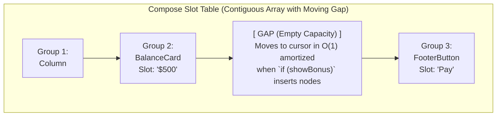

#### Code Example: Preventing Frame Drops on Scroll with `derivedStateOf`
```kotlin
@Composable
fun TransactionFeed(items: ImmutableList<String>) {
    val listState = rememberLazyListState()

    // BAD: `listState.firstVisibleItemIndex` is read directly in `TransactionFeed`'s scope.
    // Every time the user scrolls a single item, the ENTIRE `TransactionFeed` recomposes!
    // val showScrollToTop = listState.firstVisibleItemIndex > 5

    // GOOD: `derivedStateOf` isolates the high-frequency scroll reads inside a derived Snapshot!
    // `TransactionFeed` ONLY recomposes when the boolean flips from `false -> true` or `true -> false`!
    val showScrollToTop by remember {
        derivedStateOf { listState.firstVisibleItemIndex > 5 }
    }

    Box {
        LazyColumn(state = listState) {
            items(items, key = { it }) { item ->
                Text(item)
            }
        }
        if (showScrollToTop) {
            FloatingActionButton(onClick = { /* scroll to 0 */ }) {
                Text("Top")
            }
        }
    }
}
```

---

## 9. Kotlin Multiplatform (KMP) Architecture & Internals

### Q9.1: How does Kotlin/Native (iOS) handle memory management? Compare the Old Strict Memory Model vs. the Modern KMP Memory Manager.
**Level:** Advanced / Staff

#### Visual Diagram: The Cross-Runtime Reference Cycle Leak Between Swift (ARC) and Kotlin/Native (GC)
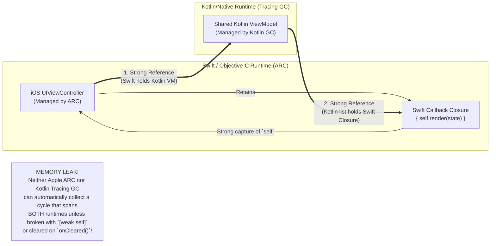

---

### Q9.2: How do `expect` / `actual` declarations work, and when should you prefer Interfaces + Dependency Injection over `expect` / `actual`?
**Level:** Advanced / Staff

#### Code Example: When to Use `expect/actual` vs `interface` + DI in KMP
```kotlin
// ============================================================================
// 1. GOOD USE OF `expect / actual`: Stateless platform intrinsic (no DI dependencies)
// ============================================================================
// In commonMain:
expect fun currentThreadName(): String

// In androidMain:
actual fun currentThreadName(): String = Thread.currentThread().name

// In iosMain:
actual fun currentThreadName(): String = platform.Foundation.NSThread.currentThread.name ?: "main"

// ============================================================================
// 2. GOOD USE OF `interface` + DI: Stateful service needing platform Context & Test Fakes
// ============================================================================
// In commonMain:
interface BiometricAuthenticator {
    suspend fun authenticate(promptTitle: String): Boolean
}

// In androidMain (Needs Activity / Context injected via Constructor -> impossible with rigid expect class!):
class AndroidBiometricAuthenticator(
    private val activityProvider: () -> FragmentActivity
) : BiometricAuthenticator {
    override suspend fun authenticate(promptTitle: String): Boolean { /* BiometricPrompt logic */ return true }
}

// In commonTest (Trivial to fake in common unit tests!):
class FakeBiometricAuthenticator(var shouldSucceed: Boolean = true) : BiometricAuthenticator {
    override suspend fun authenticate(promptTitle: String): Boolean = shouldSucceed
}
```

---

## 10. Gradle Kotlin DSL, Build Performance & K2 Compiler

### Q10.1: What changed in the Kotlin K2 Compiler (Kotlin 2.0+), and how does FIR (Frontend Intermediate Representation) speed up builds?
**Level:** Advanced / Staff

#### Code Example: Smart-Casts That Failed in K1 But Work Automatically in K2 (FIR)
```kotlin
interface Animal {
    fun makeSound()
}
interface Pet : Animal {
    fun play()
}

fun interactWithAnimal(animal: Any?) {
    // 1. Local boolean variable holding type & null checks:
    val isPlayfulPet = animal != null && animal is Pet

    if (isPlayfulPet) {
        // In Kotlin 1.x (K1): COMPILE ERROR (`animal` was still typed as `Any?`)!
        // In Kotlin 2.0+ (K2 FIR): Smart-casts `animal` to non-null `Pet` automatically!
        animal.play()
        animal.makeSound()
    }
}
```

---

### Q10.2: How do `api` vs `implementation` and Compiler ABI Fingerprinting impact Incremental Compilation in Multi-Module Android Projects?
**Level:** Staff / Principal

#### Visual Diagram: Gradle Compile Avoidance (`api` vs `implementation`)
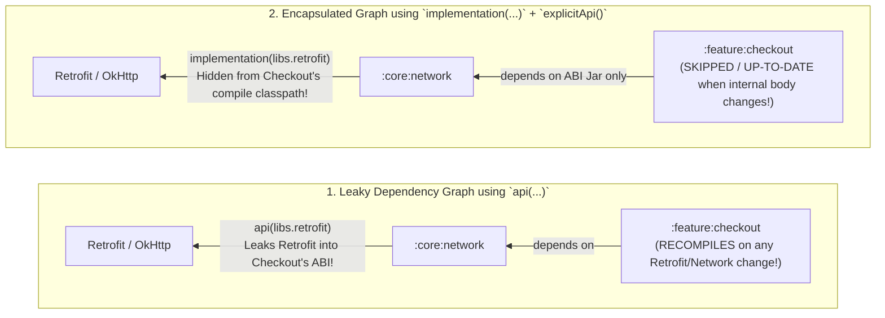

---

## 11. Staff / Principal Level Architectural & Production Scenarios

### Scenario 11.1: Designing a Thread-Safe, Backpressure-Aware Offline-First Sync Engine in Kotlin
**The Prompt:**
*"You are the Principal Engineer at FinPulse. Design an offline-first transaction synchronization engine using Coroutines and Flows. Multiple UI screens and background WorkManager jobs can trigger `syncTransactions()` simultaneously. How do you ensure:*
1. *Duplicate concurrent network requests are coalesced (in-flight deduplication) rather than dropped or duplicated?*
2. *If a `forceRefresh = true` call arrives while a normal sync is in flight, how do you handle it?*
3. *How do you ensure cancellation of one UI caller's `viewModelScope` does NOT cancel the shared network sync for other active callers?"*

#### Sequence Diagram: In-Flight Request Coalescing & Caller-Isolated Cancellation
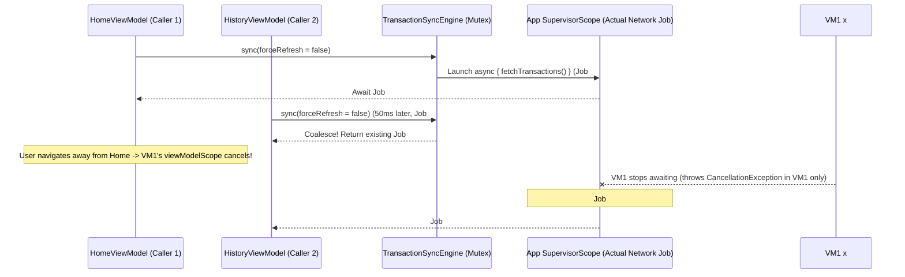

#### Principal-Level Solution & Code Architecture:
```kotlin
class TransactionSyncEngine(
    private val externalScope: CoroutineScope, // CoroutineScope(SupervisorJob() + Dispatchers.IO)
    private val api: TransactionApi,
    private val dao: TransactionDao
) {
    private val mutex = Mutex()
    private var activeSyncJob: Deferred<Result<Unit>>? = null

    suspend fun sync(forceRefresh: Boolean = false): Result<Unit> {
        val jobToAwait: Deferred<Result<Unit>> = mutex.withLock {
            if (forceRefresh) {
                activeSyncJob?.cancel()
                activeSyncJob = null
            }

            val existing = activeSyncJob
            if (existing != null && existing.isActive) {
                existing // Coalesce! Piggyback on the in-flight sync!
            } else {
                externalScope.async {
                    try {
                        runCatching {
                            val remote = api.fetchTransactions()
                            dao.upsertAll(remote)
                        }
                    } finally {
                        mutex.withLock {
                            if (activeSyncJob == this) {
                                activeSyncJob = null
                            }
                        }
                    }
                }.also { activeSyncJob = it }
            }
        }

        // Caller awaits in its own CoroutineContext!
        // If this caller's viewModelScope cancels, `jobToAwait.await()` throws CancellationException
        // for THIS caller only, while `externalScope.async` continues running for other callers!
        return jobToAwait.await()
    }
}
```
#### Bonus Trap: Why `kotlinx.coroutines.sync.Mutex` Deadlocks on Recursive/Nested Calls!
```kotlin
val mutex = Mutex()

suspend fun outerOperation() = mutex.withLock {
    // DEADLOCK! Unlike Java's `synchronized` or `ReentrantLock`, Kotlin's `Mutex` is NOT reentrant!
    // Calling `innerOperation()` while already holding `mutex` suspends forever waiting for itself!
    innerOperation()
}

suspend fun innerOperation() = mutex.withLock {
    println("Never reached!")
}
```

---

### Scenario 11.2: Diagnosing a Production ANR Caused by Coroutines & Kotlin Idioms
**The Prompt:**
*"Crashlytics reports a spike in ANRs (`Input dispatching timed out`) on the Main Thread. The stack trace of the main thread shows it blocked inside `SynchronizedLazyImpl.getValue()` or waiting on a `runBlocking` call inside a Dagger/Hilt dependency graph initialization. How do you root-cause and architecturally eliminate this?"*

#### Sequence Diagram: How a Thread-Safe `by lazy` Causes a Main-Thread ANR
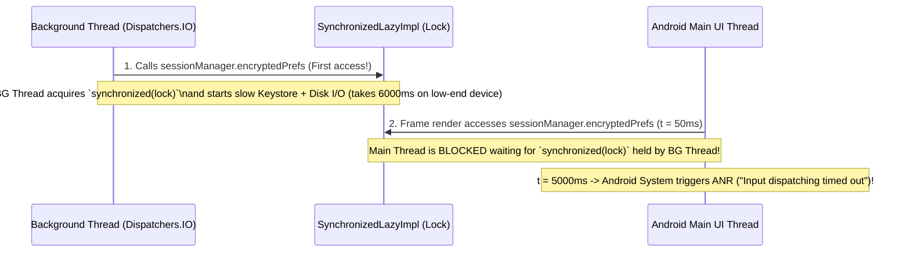

#### Code Example: Replacing Blocking `by lazy` with Non-Blocking Async Initialization
```kotlin
// BAD: Can block the Main Thread on `SynchronizedLazyImpl` monitor lock if accessed from UI and IO!
class LegacyTokenStore(context: Context) {
    val prefs: SharedPreferences by lazy {
        // Heavy disk + Android Keystore decryption inside synchronized lock!
        EncryptedSharedPreferences.create(...)
    }
}

// GOOD: Eagerly warm up on Dispatchers.IO via a Deferred, and expose a non-blocking Flow / suspend API!
class ModernTokenStore(
    context: Context,
    ioScope: CoroutineScope // CoroutineScope(SupervisorJob() + Dispatchers.IO)
) {
    private val prefsDeferred: Deferred<SharedPreferences> = ioScope.async {
        EncryptedSharedPreferences.create(...)
    }

    suspend fun getAuthToken(): String? {
        // Suspends without ever blocking the Main Thread!
        return prefsDeferred.await().getString("KEY_TOKEN", null)
    }
}
```

---

### Scenario 11.3: Designing a Binary-Compatible Public Kotlin SDK for External Consumers
**The Prompt:**
*"Your team ships a Kotlin Android SDK consumed by 50+ partner apps (some written in Java, some using older/newer Kotlin versions). If you add a new property with a default value to a `data class` in your public API, you break binary compatibility for existing compiled consumers! Why does `data class` break binary compatibility, and how do you prevent it?"*

#### Code Example: Binary-Incompatible `data class` vs. Binary-Compatible Builder/DSL Class
```kotlin
// ============================================================================
// 1. BROKEN FOR PUBLIC SDKs: `data class`
// ============================================================================
// If v1.0 has 2 properties and v2.0 adds `val description: String? = null`,
// the v1.0 bytecode signature `copy(long, String)` is DELETED from the class file,
// crashing any pre-compiled caller with `java.lang.NoSuchMethodError`!
data class BrokenSdkRequest(
    val amountCents: Long,
    val currency: String,
    val description: String? = null // <-- Adding this breaks binary compatibility of copy()!
)

// ============================================================================
// 2. SAFE FOR PUBLIC SDKs: Regular Class + Private Constructor + Kotlin DSL Builder
// ============================================================================
class SafeSdkRequest private constructor(
    val amountCents: Long,
    val currency: String,
    val description: String?
) {
    class Builder(
        private var amountCents: Long,
        private var currency: String
    ) {
        private var description: String? = null

        // Adding new optional properties in v2.0 only ADDS new methods to Builder;
        // existing compiled bytecode signatures remain 100% intact!
        fun setDescription(description: String?) = apply { this.description = description }

        fun build(): SafeSdkRequest = SafeSdkRequest(amountCents, currency, description)
    }

    override fun equals(other: Any?): Boolean =
        other is SafeSdkRequest &&
            amountCents == other.amountCents &&
            currency == other.currency &&
            description == other.description

    override fun hashCode(): Int = Objects.hash(amountCents, currency, description)
}

// Idiomatic Kotlin DSL factory function:
inline fun sdkRequest(
    amountCents: Long,
    currency: String,
    block: SafeSdkRequest.Builder.() -> Unit = {}
): SafeSdkRequest = SafeSdkRequest.Builder(amountCents, currency).apply(block).build()
```

---

## Quick-Fire Revision Checklist (Top 20 Rapid-Fire Questions)

| # | Question | 1-Sentence Staff Answer |
| :--- | :--- | :--- |
| **1** | Why can't `lateinit` be used on `Int` or `Boolean`? | Because `lateinit` uses `null` in the backing reference field to detect uninitialized state, and JVM primitives cannot hold `null`. |
| **2** | When should you use `lazy(LazyThreadSafetyMode.NONE)`? | Whenever the property is strictly accessed on a single thread (like Android's Main UI thread) to eliminate `synchronized` monitor lock overhead. |
| **3** | When does a `@JvmInline value class` get boxed on the heap? | When used as a nullable type (`MyId?` wrapping a primitive), a generic type parameter (`List<MyId>`), or cast to an interface it implements. |
| **4** | What is the memory difference between a capturing and non-capturing lambda? | A non-capturing lambda compiles to a stateless singleton (`INSTANCE` allocated once), whereas a capturing lambda allocates a new `FunctionN` closure object on the heap on every invocation. |
| **5** | Why do we need `crossinline`? | To forbid non-local `return`s when an inlined lambda is invoked inside a nested execution context (like a `Runnable` or another lambda) whose stack frame differs from the caller's. |
| **6** | Why is `Nothing` the bottom type in Kotlin? | Because `Nothing` has no instances and is a subtype of every type, allowing expressions like `throw` or `return` on the right side of `?:` to type-check seamlessly with any left-hand type. |
| **7** | Why does `List<out E>.contains(element: @UnsafeVariance E)` compile? | `@UnsafeVariance` suppresses the contravariant `in` check because `contains` only compares elements via `equals()` and never mutates/inserts them into the covariant list. |
| **8** | What does the compiler add to a `suspend` function's signature? | An extra `Continuation<T>` parameter at the end, and changes the return type to `Any?` (`Object`) so it can return either the result or `COROUTINE_SUSPENDED`. |
| **9** | How many `Continuation` objects are allocated for a `suspend` function with 4 suspension points? | Exactly **one** `ContinuationImpl` state-machine object per function invocation (or zero if every inner call completes synchronously without suspending!). |
| **10** | Why does `scope.launch(SupervisorJob()) { ... }` NOT act as a supervisor for its children? | Because `launch` creates a new regular `StandaloneCoroutine` (`Job`) as a child of the passed `SupervisorJob`, so inner coroutines have a regular `Job` as their immediate parent. |
| **11** | Why is `catch (e: Exception)` dangerous inside a coroutine? | It catches `CancellationException`, breaking cooperative cancellation and leaving the coroutine's `Job` in a `Cancelling` state where subsequent `suspend` calls immediately fail. |
| **12** | Do `Dispatchers.Default` and `Dispatchers.IO` have separate thread pools? | No, they share the same underlying work-stealing `CoroutineScheduler` thread pool with different concurrency quotas (`CPU cores` vs `max(64, cores)`). |
| **13** | Why does `StateFlow` ignore duplicate emissions? | `StateFlow` always enforces structural equality (`Any.equals`) conflation; if `newValue == oldValue`, it is a no-op and collectors are not notified. |
| **14** | Why does `MutableSharedFlow().tryEmit(x)` return `false` and drop the item? | Because `MutableSharedFlow()` defaults to `replay = 0` and `extraBufferCapacity = 0`, and non-suspending `tryEmit` cannot suspend waiting for collectors without buffer space. |
| **15** | Why pass `5000` to `SharingStarted.WhileSubscribed(5000)`? | It keeps the upstream flow alive for 5 seconds when subscribers drop to 0 so Android configuration changes (screen rotations) don't tear down and restart upstream streams. |
| **16** | Why is `@JvmOverloads` dangerous on Android `Button` / `TextView` subclasses? | The generated 2-arg constructor passes `defStyleAttr = 0` to the 3-arg constructor instead of the view's default style attribute (e.g., `R.attr.buttonStyle`), breaking Material theme styling. |
| **17** | How does the Compose Compiler transform `@Composable` functions? | It injects a `$composer: Composer?` and `$changed: Int` bitmask parameter to track slot-table group positions and skip recomposition when inputs haven't changed. |
| **18** | How does Compose Strong Skipping Mode handle unstable parameters like `List<T>`? | Instead of making the composable non-skippable, it compares unstable parameters by referential equality (`===`) and stable parameters by structural equality (`equals`). |
| **19** | Is `kotlinx.coroutines.sync.Mutex` reentrant? | **No!** Acquiring the same `Mutex` nested inside `mutex.withLock` in the same coroutine will permanently deadlock the coroutine. |
| **20** | Why should you avoid `data class` in public SDK APIs? | Adding a property breaks binary compatibility (`NoSuchMethodError`) for existing compiled callers of the generated `copy()` and positional `componentN()` methods. |

---
*Prepared for Senior, Staff, and Principal Android Engineering Interviews.*
